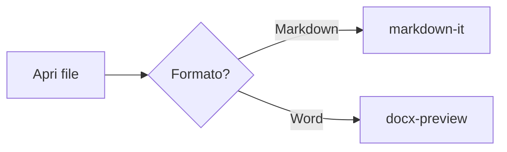

# Nota di prova per 151 Viewer

Testo con **grassetto**, *corsivo*, ***entrambi***, ~~barrato~~, `codice in linea` e ==evidenziato==.
Un link esterno [Obsidian](https://obsidian.md), un [[Wikilink]], un [[Altra nota|alias mostrato]] e un tag #progetto/viewer.
Nota a piè di pagina[^1] e un'altra[^lunga].

## Liste

- primo punto
- secondo punto
  - annidato
1. uno
2. due

- [ ] da fare
- [x] fatto
- [/] a metà
- [-] annullato

## Tabella

| Formato | Libreria | Licenza |
|:--|:-:|--:|
| Markdown | markdown-it | MIT |
| Excel | SheetJS | Apache-2.0 |
| Word | docx-preview | Apache-2.0 |

## Callout

> [!note] Nota
> Un callout semplice con **markdown** dentro.

> [!warning]- Attenzione (pieghevole, chiuso)
> Contenuto nascosto finché non lo apri.

> [!tip]+ Suggerimento (pieghevole, aperto)
> Aperto di default.

> [!danger]
> Senza titolo: prende il nome del tipo.

> Citazione normale
> su due righe.

## Codice

```python
def saluta(nome: str) -> str:
    # commento
    return f"Ciao {nome}!"
```

```js
const x = [1, 2, 3].map(n => n * 2);
console.log(x);
```

## Matematica

In linea: $e^{i\pi} + 1 = 0$ e $\sqrt{a^2+b^2}$.

$$
\int_0^1 x^2\,dx = \frac{1}{3}
$$

## Diagramma



## Immagini


![[immagine.png|120]]

Immagine remota (bloccata, niente rete): 

%%commento Obsidian: non si vede%%

---

Fine. <script>alert('xss')</script> 

[^1]: La prima nota.
[^lunga]: Una nota più lunga, con *corsivo*.
